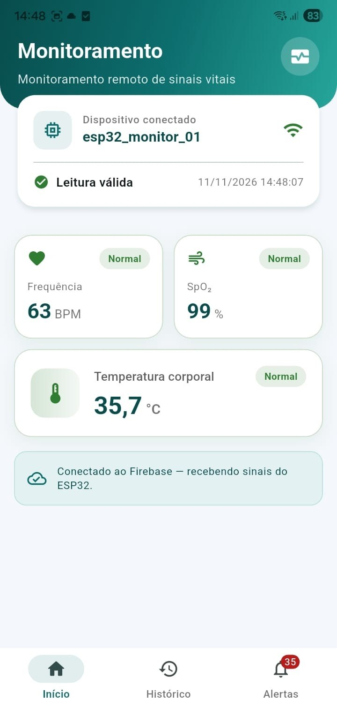
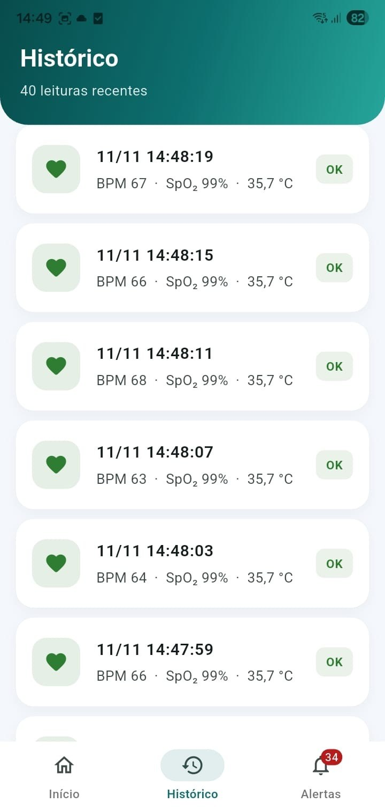
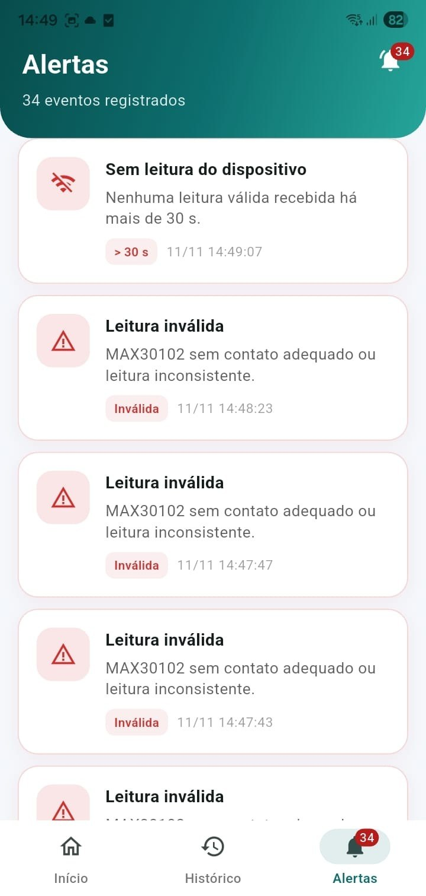
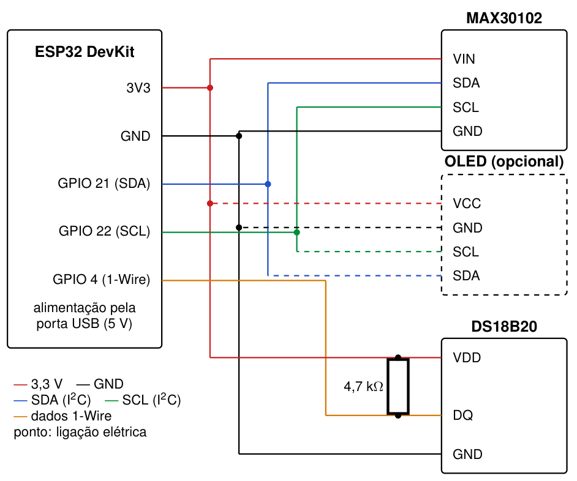

# Monitoramento remoto de sinais vitais com IoT (TCC)

Protótipo para monitoramento remoto de **frequência cardíaca**, **saturação periférica de oxigênio (SpO₂)** e **temperatura corporal**, com aplicativo próprio para acompanhar as leituras à distância, desenvolvido como Trabalho de Conclusão de Curso do Bacharelado em Ciência da Computação da Universidade Tuiuti do Paraná (UTP), 2026.

- **Autor:** Luiz Eduardo Farago Ribeiro da Silva
- **Orientador:** Prof. Me. Chauã Queirolo

> Projeto acadêmico, sem finalidade clínica. O protótipo não substitui equipamentos médicos regularizados.

📘 **[Manual de utilização completo, com prints e passo a passo](docs/MANUAL.md)**

## Como funciona

```
MAX30102 (BPM e SpO₂) ─┐
                       ├─ ESP32 ── HTTPS (PUT/POST) ──> Firebase Realtime Database <── consulta a cada 2 s ── Aplicação web (Flutter)
DS18B20 (temperatura) ─┘
```

1. O ESP32 lê os sensores, valida cada leitura e, a cada 3 s, grava o registro JSON nos nós `latest` (leitura atual) e `history` (histórico) do Firebase.
2. O aplicativo, feito em Flutter e usado no navegador ou instalado no Android, consulta o banco a cada 2 s, mostra os valores e o histórico e gera alertas (SpO₂ < 94%, FC < 50 ou > 120 BPM, temperatura ≥ 37,8 °C, leitura inválida e ausência de leituras por mais de 30 s).

## Estrutura do repositório

| Pasta | Conteúdo |
|---|---|
| `firmware/esp32_firebase_monitor/` | Firmware do ESP32 (Arduino IDE) |
| `app/` | Aplicativo em Flutter: aplicação web e APK para Android |
| `docs/` | [Manual de utilização](docs/MANUAL.md) e imagens (`docs/img/`) |

## Telas do aplicativo

| Início | Histórico | Alertas |
|---|---|---|
|  |  |  |

*Aplicativo instalado em um celular Android, com leituras reais do protótipo.*

## Hardware

| Componente | Ligação no ESP32 |
|---|---|
| MAX30102 (I²C) | SDA → GPIO 21, SCL → GPIO 22, VCC → 3V3, GND → GND |
| OLED SSD1306 0,96" (opcional, I²C) | mesmo barramento do MAX30102 |
| DS18B20 (1-Wire) | DATA → GPIO 4, com resistor de 4,7 kΩ entre DATA e 3V3 |



Custo estimado dos componentes: R$ 165,18 com o OLED e R$ 136,28 sem ele (preços de novembro de 2026).

## Firmware

1. Arduino IDE 2.3.10 com o pacote **esp32** (Espressif) 3.3.11, placa *ESP32 Dev Module*.
2. Bibliotecas: SparkFun MAX3010x 1.1.2, OneWire 2.3.8, DallasTemperature 4.0.6, Adafruit SSD1306 2.5.17 e Adafruit GFX 1.12.6.
3. Em `firmware/esp32_firebase_monitor/esp32_firebase_monitor.ino`, troque `SUA_REDE_WIFI`, `SUA_SENHA_WIFI` e `SEU-PROJETO` pelos dados da sua rede e do seu projeto Firebase.
4. Grave o programa e confira as leituras no Monitor Serial (115200).

## Firebase

1. Crie um projeto no [Console do Firebase](https://console.firebase.google.com/) e um **Realtime Database**.
2. Registre um app web e copie as chaves para `app/lib/config/firebase_config.dart`, no lugar dos marcadores (`SUA_API_KEY`, `SEU-PROJETO` etc.).
3. As regras abertas servem apenas para testes. Fora deles, restrinja leitura e escrita e exija autenticação.

## Aplicativo (Flutter)

Flutter 3.41.9 / Dart 3.11.5.

```bash
cd app
flutter pub get
flutter run -d chrome          # executar localmente
flutter build web              # gerar a versão web
firebase deploy                # publicar no Firebase Hosting (após firebase login)
flutter build apk --release    # APK para Android (o app aparece como "Monitoramento IoT")
```

Detalhes de configuração, uso das telas e solução de problemas estão no [manual](docs/MANUAL.md).

## Créditos

A rotina `maxim_heart_rate_and_oxygen_saturation` e o arquivo `spo2_algorithm.h` fazem parte da biblioteca SparkFun MAX3010x, adaptados pela SparkFun do projeto de referência MAXREFDES117 da Maxim Integrated; no protótipo, essa rotina é usada apenas para a SpO₂. A estrutura da leitura do sensor segue o exemplo `Example8_SPO2` da mesma biblioteca, mas cada amostra é lida com `getFIFORed()`/`getFIFOIR()`. O BPM é calculado por autocorrelação (função `bpmAutocorrelacao()`), com filtro de mediana e índice de qualidade, e o envio ao Firebase roda em uma tarefa separada, no segundo núcleo do ESP32.

## Licença

Distribuído sob a licença MIT. Veja o arquivo [LICENSE](LICENSE).
