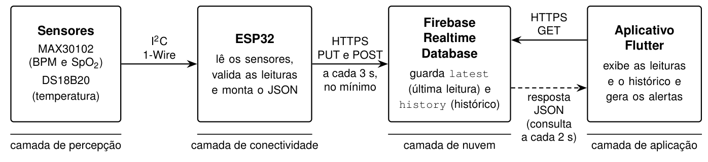
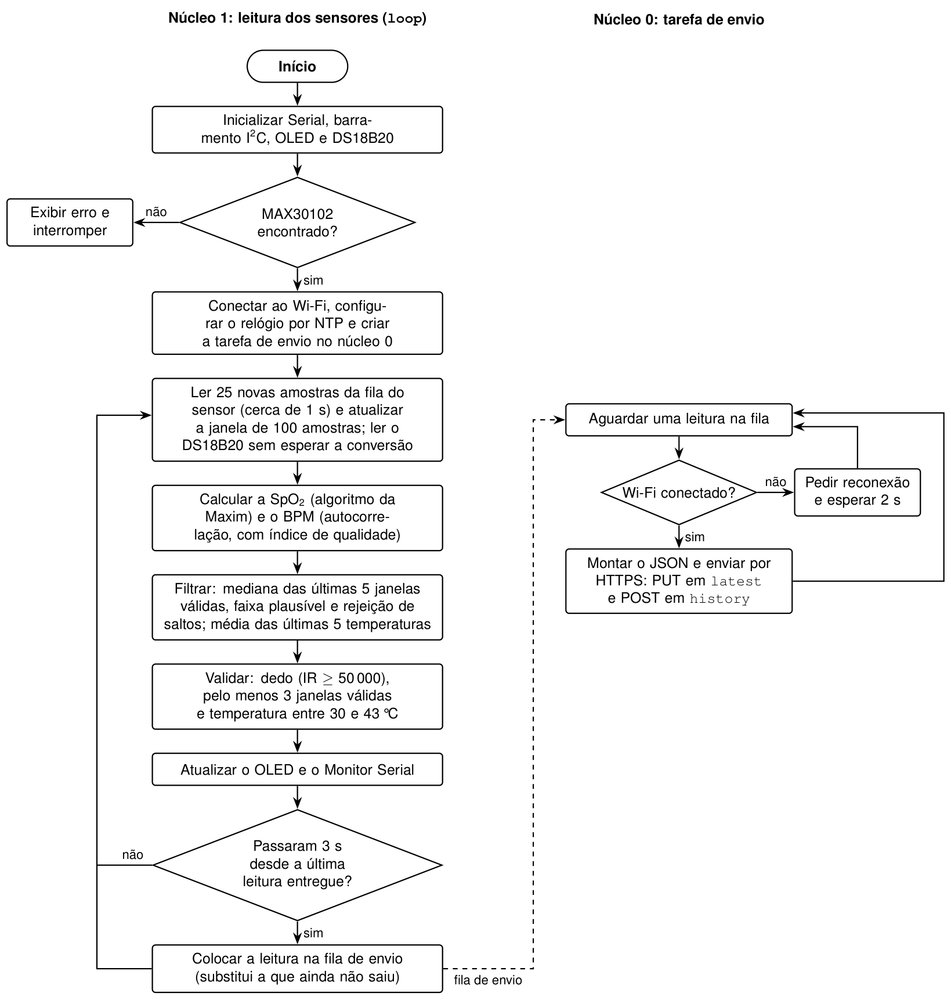
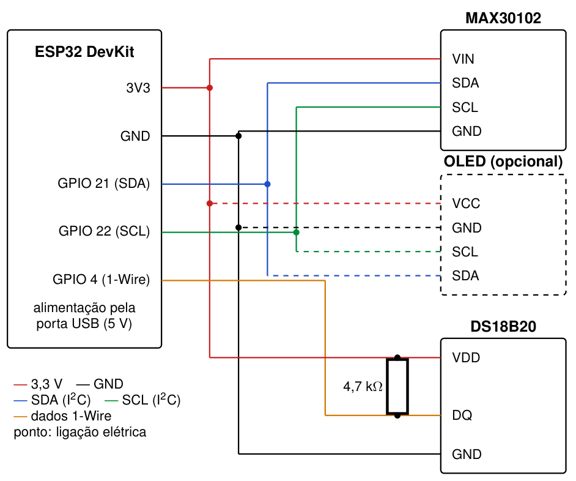
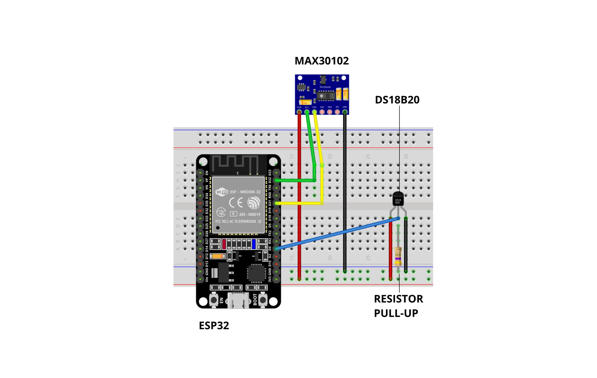
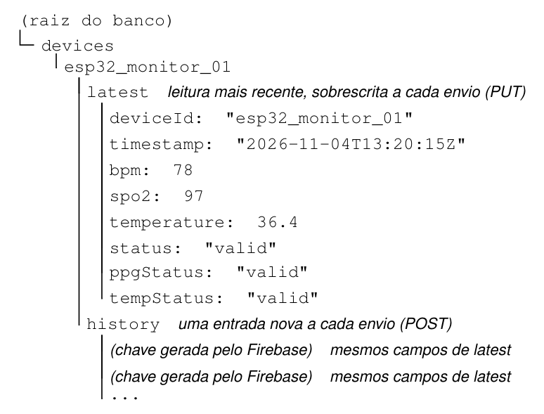
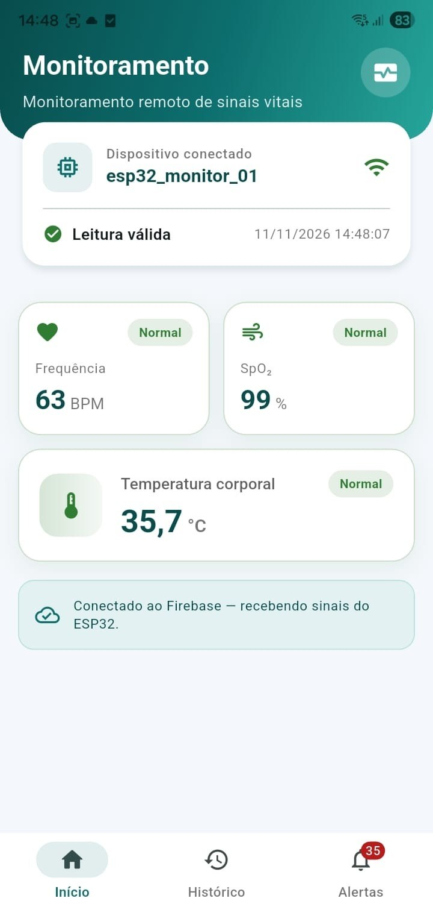
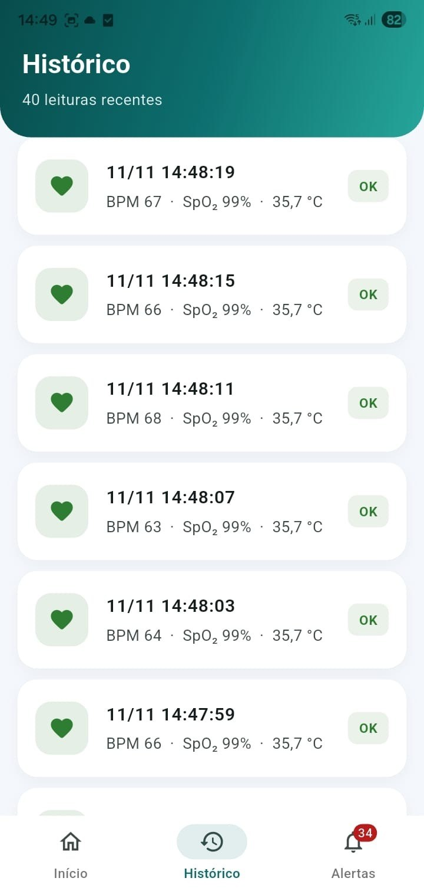
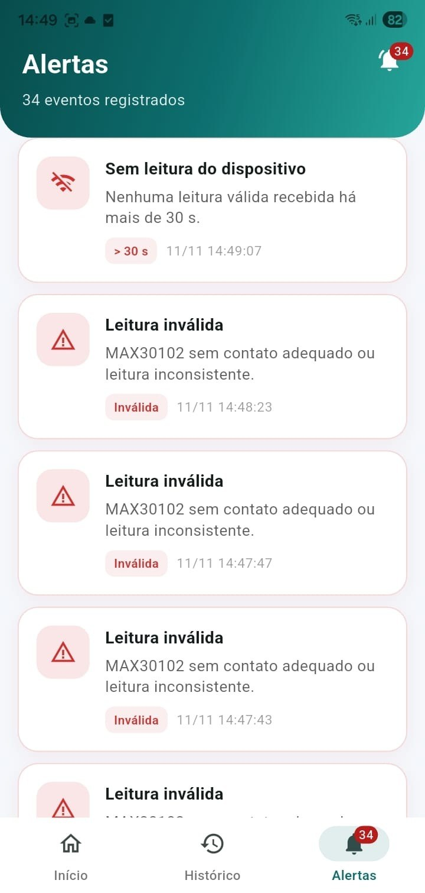
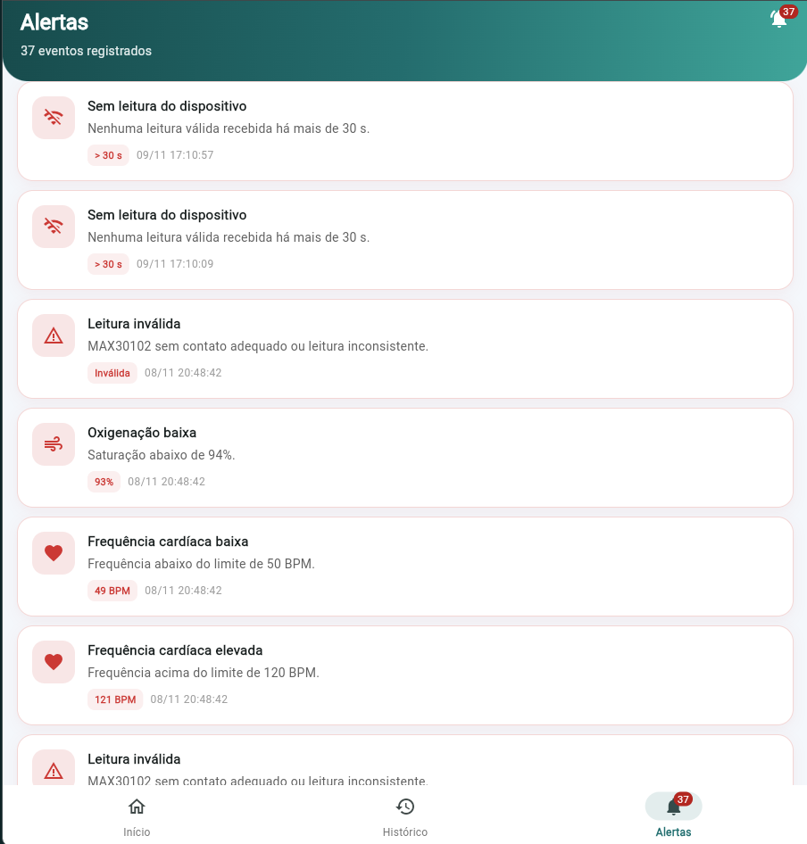

# Manual de utilização do protótipo e do software

Este manual explica como montar, configurar e usar o sistema de monitoramento remoto de sinais vitais: o hardware (ESP32 com sensores), o banco de dados no Firebase e o aplicativo em Flutter. Ele é a versão online do Apêndice A do TCC e serve para orientar quem for repetir o experimento ou demonstrar o protótipo.

> **Aviso:** projeto acadêmico, sem finalidade clínica. O protótipo não substitui oxímetros, termômetros ou monitores regularizados na ANVISA.

## Sumário

1. [Visão geral do sistema](#1-visão-geral-do-sistema)
2. [O que é preciso ter em mãos](#2-o-que-é-preciso-ter-em-mãos)
3. [Conexões do circuito](#3-conexões-do-circuito)
4. [Configuração do Firebase](#4-configuração-do-firebase)
5. [Gravação do firmware](#5-gravação-do-firmware)
6. [Instalação e execução do aplicativo](#6-instalação-e-execução-do-aplicativo)
7. [Uso do protótipo](#7-uso-do-protótipo)
8. [Uso do aplicativo](#8-uso-do-aplicativo)
9. [Problemas comuns e o que fazer](#9-problemas-comuns-e-o-que-fazer)
10. [Encerramento da sessão](#10-encerramento-da-sessão)

---

## 1. Visão geral do sistema

O ESP32 lê a frequência cardíaca (BPM), a saturação de oxigênio (SpO₂) e a temperatura, envia os dados ao Firebase, e o aplicativo mostra os valores, o histórico e os alertas. Para usar o sistema, são necessários uma rede Wi-Fi de 2,4 GHz, alimentação USB para o ESP32 e o aplicativo aberto no navegador (computador ou celular) ou instalado no Android.



No ESP32, o programa usa os dois núcleos: um lê os sensores sem parar, e o outro envia as leituras ao Firebase.

<details>
<summary>Fluxograma do firmware</summary>



</details>

## 2. O que é preciso ter em mãos

- placa ESP32 DevKit;
- módulo MAX30102 (BPM e SpO₂);
- sensor DS18B20 (temperatura) e resistor de pull-up de 4,7 kΩ;
- display OLED SSD1306 de 0,96" (opcional, para ver as leituras na bancada);
- protoboard, jumpers e cabo USB **que transmita dados**;
- fonte USB: computador ou power bank de 5 V;
- rede Wi-Fi de 2,4 GHz com senha conhecida;
- computador com Arduino IDE e Flutter SDK (versões na tabela abaixo);
- conta Google, para criar o projeto no Firebase.

| Ferramenta ou biblioteca | Versão usada |
|---|---|
| Arduino IDE | 2.3.10 |
| Pacote esp32 (Espressif) | 3.3.11 |
| SparkFun MAX3010x | 1.1.2 |
| OneWire | 2.3.8 |
| DallasTemperature | 4.0.6 |
| Adafruit SSD1306 / Adafruit GFX | 2.5.17 / 1.12.6 |
| Flutter / Dart | 3.41.9 / 3.11.5 |
| Pacote `http` (Dart) | 1.6.0 |

## 3. Conexões do circuito

| Componente | Pino do componente | Pino do ESP32 |
|---|---|---|
| MAX30102 | VIN / GND | 3V3 / GND |
| MAX30102 | SDA / SCL | GPIO 21 / GPIO 22 |
| OLED SSD1306 (opcional) | VCC / GND | 3V3 / GND |
| OLED SSD1306 (opcional) | SDA / SCL | GPIO 21 / GPIO 22 (mesmo barramento do MAX30102) |
| DS18B20 | VDD / GND | 3V3 / GND |
| DS18B20 | DQ (dados) | GPIO 4, com resistor de 4,7 kΩ entre DQ e 3V3 |





Antes de ligar:

- confira se não há fio solto;
- confira se o resistor do DS18B20 está entre o pino de dados e o **3V3**, e não entre o pino de dados e o GND.

Com o firmware em execução, o OLED mostra BPM, SpO₂ e temperatura, o que permite testar o circuito sem depender do aplicativo.

## 4. Configuração do Firebase

1. No [Console do Firebase](https://console.firebase.google.com/), crie um projeto e, no menu **Realtime Database**, crie um banco de dados.
2. Copie a URL do banco, no formato `https://<projeto>-default-rtdb.firebaseio.com`. Ela vai no firmware e no aplicativo.
3. Nos testes, as regras de acesso precisam permitir a leitura e a gravação no caminho `devices`. Fora do ambiente de testes, restrinja as regras a usuários autenticados.
4. Nas configurações do projeto, registre um **aplicativo web** para obter as chaves usadas em `app/lib/config/firebase_config.dart`.
5. Para publicar a aplicação web, ative o **Firebase Hosting** no mesmo projeto.

Estrutura dos dados gravados pelo ESP32:



- `latest`: leitura mais recente, sobrescrita a cada envio (PUT);
- `history`: uma entrada nova a cada envio (POST), com os mesmos campos.

## 5. Gravação do firmware

1. Baixe este repositório (botão **Code → Download ZIP** ou `git clone https://github.com/dufarago/tcc-iot.git`).
2. No Arduino IDE, instale:
   - o pacote de placas **esp32** da Espressif (*Ferramentas → Placa → Gerenciador de Placas*);
   - as bibliotecas SparkFun MAX3010x, OneWire, DallasTemperature, Adafruit SSD1306 e Adafruit GFX (*Ferramentas → Gerenciar Bibliotecas*).
3. Abra `firmware/esp32_firebase_monitor/esp32_firebase_monitor.ino` e ajuste as constantes do início do código:

   | Constante | O que colocar |
   |---|---|
   | `WIFI_SSID` | nome da rede de 2,4 GHz (no lugar de `SUA_REDE_WIFI`) |
   | `WIFI_PASSWORD` | senha da rede (no lugar de `SUA_SENHA_WIFI`) |
   | `DATABASE_URL` | URL do Realtime Database (no lugar de `SEU-PROJETO`) |
   | `DEVICE_ID` | identificador do dispositivo (padrão: `esp32_monitor_01`) |

4. Selecione a placa **ESP32 Dev Module** e a porta COM correta e grave o programa.
   - Se a gravação falhar, mantenha pressionado o botão **BOOT** da placa no início da gravação e use a velocidade de upload de 115200.
5. Abra o **Monitor Serial** em 115200 e confira:
   - a conexão Wi-Fi;
   - as linhas com os valores lidos e a validade de cada sensor (`ppg=valid` e `temp=valid`);
   - o código HTTP de cada envio, que deve ser **200**.
6. No Console do Firebase, confira se o nó `latest` do dispositivo é atualizado a cada envio.

> Se o Wi-Fi não conectar, confira se a rede é de 2,4 GHz: o ESP32 não usa a faixa de 5 GHz.

## 6. Instalação e execução do aplicativo

### 6.1 Configuração

No arquivo `app/lib/config/firebase_config.dart`:

- substitua os marcadores (`SUA_API_KEY`, `SEU_APP_ID`, `SEU-PROJETO` e os demais) pelos dados do projeto criado na seção 4;
- mantenha `enabled = true`;
- confira se `deviceId` é igual ao `DEVICE_ID` do firmware.

Com a configuração incompleta, o aplicativo abre no **modo de simulação**, que serve apenas para ver as telas.

### 6.2 Execução no navegador

```bash
cd app
flutter pub get                 # baixa as dependências (primeira execução)
flutter run -d chrome           # abre o aplicativo no Google Chrome
```

Para publicar a aplicação web no Firebase Hosting (com o Firebase CLI e após `firebase login`):

```bash
flutter build web
firebase deploy --only hosting  # ou: npx firebase-tools deploy --only hosting
```

Depois disso, o aplicativo é acessado pelo endereço do Hosting (`https://<projeto>.web.app`), no navegador do computador ou do celular.

O console do navegador (tecla F12) e o terminal do `flutter run` mostram, a cada leitura nova, a mensagem `Latencia da leitura`, com a latência em milissegundos.

### 6.3 Aplicativo para Android (APK)

1. Confira se `app/android/app/src/main/AndroidManifest.xml` declara a permissão de internet (já incluída neste repositório):

   ```xml
   <uses-permission android:name="android.permission.INTERNET"/>
   ```

   Sem ela, a versão de distribuição instala e abre, mas não recebe dados do Firebase.
2. Na primeira vez, aceite as licenças do Android: `flutter doctor --android-licenses`.
3. Gere o instalador:

   ```bash
   cd app
   flutter build apk --release
   ```

   O arquivo sai em `app/build/app/outputs/flutter-apk/app-release.apk`.
4. Copie o APK para o celular (cabo USB, Google Drive ou WhatsApp), abra o arquivo e permita a instalação de aplicativos desta fonte. O app aparece como **Monitoramento IoT**.

> Se o build parar com "Gradle build daemon disappeared", falta memória: feche outros programas, rode `cd android && ./gradlew --stop` e gere de novo. O `gradle.properties` deste repositório já limita o Gradle a 3 GB.

Para testar direto no aparelho, com depuração USB ativada: `flutter devices` e `flutter run -d <id do dispositivo>`.

## 7. Uso do protótipo

### 7.1 Passo a passo

1. **Ligar:** conecte o cabo USB ao ESP32 e aguarde a conexão ao Wi-Fi, indicada no Monitor Serial e no OLED.
2. **Medir BPM e SpO₂:** com o MAX30102 apoiado em uma superfície firme, coloque o dedo indicador sobre a janela do sensor, **sem apertar**, e mantenha a mão parada. A leitura óptica fica válida em cerca de 10 a 60 segundos.
3. **Medir a temperatura:** coloque a sonda do DS18B20 na axila, com o braço encostado no corpo, e aguarde cerca de **5 minutos** até a leitura estabilizar.
4. **Conferir o envio:** o ESP32 envia os dados ao Firebase (nós `latest` e `history`) a cada 3 a 4 segundos, e o Monitor Serial mostra o código HTTP de cada envio.
5. **Encerrar:** retire o dedo do sensor, desligue a alimentação USB e guarde o protótipo em local seco.

### 7.2 Leitura no display OLED

O OLED mostra os valores atuais de BPM, SpO₂ e temperatura. Quando a temperatura está fora da faixa de 30 °C a 43 °C (por exemplo, em testes com água gelada), o valor aparece com um asterisco e é enviado ao Firebase como inválido.

Se o OLED não acender, confira o endereço I²C (`0x3C`), a alimentação em 3,3 V e os pinos SDA e SCL.

### 7.3 Cuidados com o hardware

- use cabo USB que transmita dados, e não apenas carga, para gravar o firmware;
- evite umidade na protoboard e nos sensores;
- se a leitura óptica ficar inválida, limpe a janela do MAX30102, reposicione o dedo e aguarde;
- não exponha o DS18B20 a temperaturas fora da faixa indicada pelo fabricante;
- o protótipo não mede pressão arterial.

## 8. Uso do aplicativo

O aplicativo tem três abas na barra inferior: **Início**, **Histórico** e **Alertas**. As capturas abaixo são do aplicativo instalado em um celular Android, com leituras reais do protótipo.

| Início | Histórico | Alertas |
|---|---|---|
|  |  |  |

### 8.1 Tela Início

Mostra a situação da conexão, a data e a hora da última leitura (horário local) e os cartões com BPM, SpO₂ e temperatura. As cores indicam faixa normal, de atenção (amarelo) ou de alerta (vermelho). Quando a leitura de um sensor é inválida, o cartão correspondente mostra `--`, e os demais continuam com os valores do outro sensor.

Se a tela ficar carregando por muito tempo, verifique o Wi-Fi do ESP32, a URL do Firebase e o `deviceId`.

### 8.2 Tela Histórico

Lista as 40 leituras mais recentes do nó `history`, da mais nova para a mais antiga, indicando se cada uma é válida. Se a lista estiver vazia, confira se o ESP32 está enviando os registros (código HTTP 200 no Monitor Serial).

### 8.3 Tela Alertas

Mostra os avisos gerados quando:

| Condição | Alerta |
|---|---|
| SpO₂ abaixo de 94% | Oxigenação baixa |
| BPM acima de 120 | Frequência cardíaca elevada |
| BPM abaixo de 50 | Frequência cardíaca baixa |
| Temperatura igual ou acima de 37,8 °C | Temperatura elevada |
| Leitura inválida de um dos sensores | Leitura inválida |
| Nenhuma leitura válida nova por mais de 30 s | Sem leitura do dispositivo |

O número na aba Alertas indica quantos avisos estão na lista. Os alertas são apenas informativos e aparecem com o aplicativo aberto.

<details>
<summary>Tela Alertas na versão web, durante os testes</summary>



</details>

## 9. Problemas comuns e o que fazer

| Problema | O que verificar |
|---|---|
| ESP32 não conecta ao Wi-Fi | Rede de 2,4 GHz, SSID e senha corretos no `.ino` |
| Falha na gravação do firmware | Cabo USB com dados, porta COM correta, botão BOOT pressionado no início da gravação |
| Aplicativo sem dados | Mesmo `deviceId` no ESP32 e no `firebase_config.dart`; URL e regras do Firebase |
| APK instala, mas não mostra dados | Permissão `INTERNET` no `AndroidManifest.xml` (seção 6.3) |
| BPM e SpO₂ sempre inválidos | Dedo apoiado sem apertar, sensor fixo, aguardar até 60 s, evitar movimento |
| Temperatura baixa ou instável | Sonda bem encostada na pele, braço fechado, cerca de 5 min de contato |
| Temperatura inválida ou com asterisco | Contato da sonda, ligação do resistor de 4,7 kΩ, faixa de 30 °C a 43 °C |
| OLED apagado | Alimentação de 3,3 V, SDA no GPIO 21, SCL no GPIO 22, endereço `0x3C` |
| Erro HTTP no Monitor Serial | URL do Firebase, acesso à internet da rede, regras do Realtime Database |

## 10. Encerramento da sessão

Ao terminar, retire o dedo do sensor, desligue o ESP32 e feche o aplicativo. Para guardar o protótipo, fixe os fios ou desmonte o circuito com cuidado, para evitar curto-circuito. Para uma nova sessão, repita os passos a partir da [seção 7](#7-uso-do-protótipo).

---

[← Voltar ao README](../README.md)
